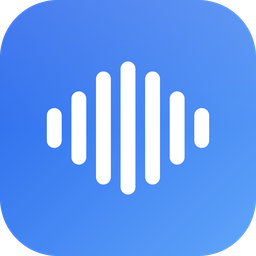
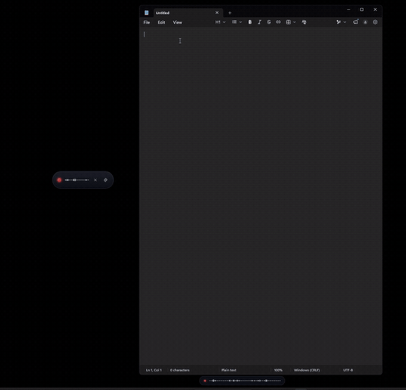
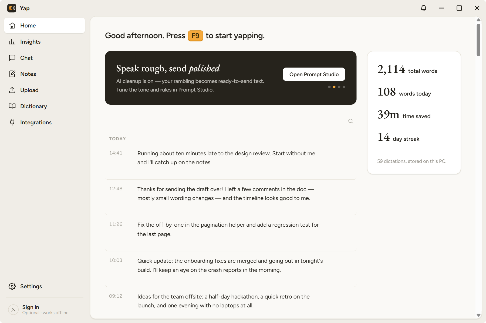
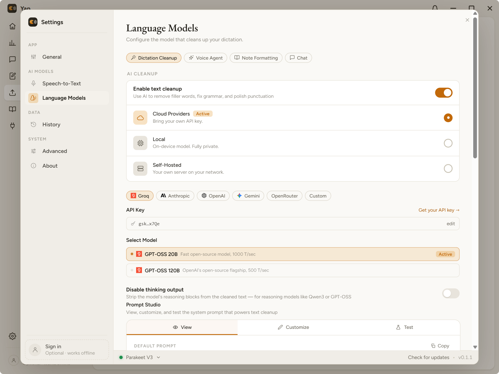
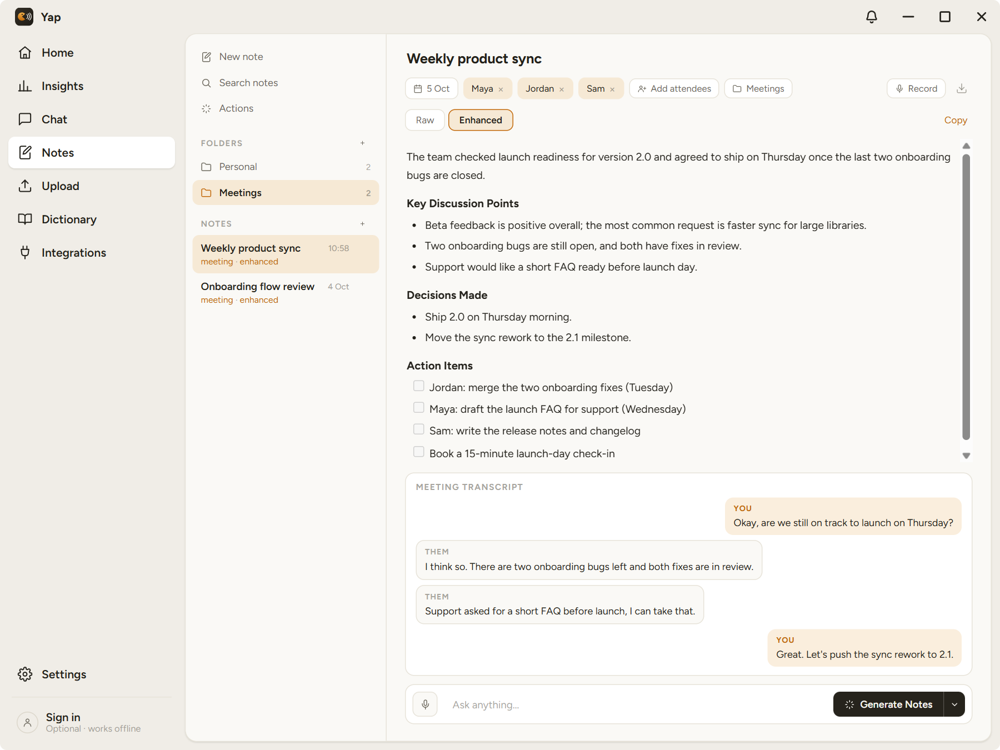

<div align="center">



# Yap

**Talk instead of type — anywhere on Windows.**

Press a hotkey, speak, press again. Yap transcribes on your GPU — locally, privately,
free — cleans up the "um"s and grammar with AI, and types the result into whatever
app you're in.

[](https://github.com/nayballs/Yap/actions/workflows/ci.yml)

-8A2BE2)


**[⬇ Download for Windows](https://github.com/nayballs/Yap/releases/latest/download/Yap-setup.exe)** · [release notes](https://github.com/nayballs/Yap/releases/latest) · [nightly](https://github.com/nayballs/Yap/releases/tag/nightly)



</div>

---

## Why Yap?

Yap is dictation and meeting notes for Windows that run on your own PC:

- 🔒 **Local from end to end.** Your speech is transcribed on your PC, and the AI
  cleanup can run there too, offline, with no account and no key. Prefer a cloud
  model? Bring your own key.
- ⌨️ **Pasting that knows the app it types into.** Terminals get their own paste keys
  and one tidy line, Claude Code and Codex (in Windows Terminal) keep your line
  breaks, a short chat message loses its full stop, and nothing you dictate is left in
  Win+V clipboard history.
- 🗓️ **Meeting notes that stay on your PC.** Yap notices a Teams, Zoom or Meet call and
  offers to take notes, keeps its windows out of screen shares, and writes an action
  plan whose owners and deadlines are checked against what was actually said.
- 🗣️ **A voice assistant that's local too.** Ask out loud from any app and hear the
  answer in a voice that runs on your PC.
- 💸 **Free and open source** (MIT). No telemetry, and no account needed.

```
🎤 your voice → Whisper / Parakeet (LOCAL, on your GPU) → raw transcript
             → AI cleanup (built-in local model, optional) → polished text
             → typed into the focused app
```

<div align="center">

<br /><br />


</div>

## Features

- 🎙️ **Dictate into anything** — one global hotkey (default `F9`), toggle or
  push-to-talk. The text lands in whatever window has focus: Slack, email, your IDE.
- ⚡ **Local GPU transcription** — 14 models to choose from (Parakeet, Whisper,
  Moonshine, SenseVoice, Canary…), downloaded in-app and SHA-256 verified. Runs on
  **any** GPU — NVIDIA, AMD, or Intel — via Vulkan + DirectML. No CUDA. CPU fallback included.
- 🧠 **AI cleanup, private by default** — one click downloads a local model (Qwen3.5 4B
  where your graphics card runs it well, else Qwen2.5 1.5B, via Mozilla llamafile)
  that strips filler words, fixes punctuation and
  grammar, and resolves "no wait, I meant…" self-corrections — **entirely on your PC**.
  Prefer your own stack? Point it at Ollama/LM Studio, or bring a Groq/OpenAI key.
  Even bring your own GGUF.
- 🎯 **Per-app cleanup profiles** — terse for Slack, formal for email, code-aware for
  your editor. Yap detects the app you're dictating into and applies the right style —
  and each profile can even run its **own AI model** (e.g. email on a strong cloud
  model, chat on the fast local one).
- ✏️ **Voice edit/rewrite mode** — bind a second hotkey, select some text, and *say* the
  change: "make this a bullet list", "more concise", "fix the grammar", "translate to
  French". Yap rewrites the selection in place. With nothing selected it writes new text
  from your instruction.
- 📊 **History & stats** — a local-only log of your dictations plus a dashboard:
  time saved vs typing, day streak, 30-day activity heatmap.
- 📖 **Correction dictionary** — teach it your jargon once ("Power to Keep" → "Parakeet"),
  never fix it again.
- 🗒️ **AI Notepad** — folders, an Actions engine (Generate Notes, Action Items…),
  attendees, and one-click markdown export.
- 🗓️ **Meeting recorder** — captures mic + system audio as a live You/Them
  transcript and auto-writes meeting minutes when you stop.
- 📤 **Upload & transcribe** — drop in an existing audio file for fully local
  transcription, no cloud round-trip.
- 💬 **AI chat over your notes** — ask questions grounded in your notes, backed by
  a local tool-calling loop that can search, create, and update notes for you.
- 🌍 **Multilingual** — per-model language selection and translate-to-English.
- 🍰 **Polished, minimal UI** — a floating waveform overlay while you speak, a live
  preview of the words as you say them, and a state-aware tray icon.
- 👤 **Optional account** — sign in with Google, GitHub, Discord or an email code,
  or scan a QR code with your phone. See and sign out the devices you're signed in
  on. Dictation never needs an account.
- 📦 **Zero-friction install** — small NSIS installer (normal or portable), in-app
  auto-updates, autostart option.

## Quick start

1. **[Download the installer](https://github.com/nayballs/Yap/releases/latest/download/Yap-setup.exe)** and run it.
   > Builds are not yet Authenticode-signed, so SmartScreen will warn on first run —
   > click *More info → Run anyway*. (Signing is on the way.)
2. Pick a model in onboarding — the default **Parakeet V3** is fast and accurate.
3. Press **F9**, talk, press **F9** again. That's it.
4. *(Optional)* Settings → **Language Models** → enable → **Local** for polished
   text with nothing ever leaving your machine.

## Privacy

- **Your voice never leaves your PC.** Transcription is 100% local, always.
- AI cleanup is **off by default**; the built-in option runs locally too. Cloud
  providers are strictly opt-in, bring-your-own-key.
- Dictation history is stored **only on your machine** and can be disabled or cleared
  in Settings. No telemetry.
- Yap goes online only to download models, check for updates (you can turn that
  off), reach a cloud AI provider you set up, read a **calendar you connect**
  (straight from Google or your calendar's link, read-only; meetings stay on
  your PC), or for the **optional account**. A
  signed-out Yap contacts the account service only when you open its Account page
  ([privacy policy](https://auth.contextmirror.com/privacy)).

## Building from source

```bash
git clone https://github.com/nayballs/Yap && cd Yap
npm ci

# full GPU pipeline (needs the Vulkan SDK: https://vulkan.lunarg.com)
npm run tauri dev -- --features engines

# fast UI-only build (stubbed transcription, no SDK needed)
npm run tauri dev
```

On Windows, `scripts\dev.bat` wraps the above with hot reload and sensible defaults.
Release installers build with `--features engines`: one installer, GPU-accelerated on
any GPU, nothing extra to install for end users.

## Docs & roadmap

- [`docs/architecture/`](./docs/architecture/README.md) — architecture deep-dive, one file per area (dictation, meetings, chat, the Yap bar…).
- [`CLAUDE.md`](./CLAUDE.md) — the short version: module index, build, test and release workflow.

Yap is pre-1.0 and moving fast. The download above is the **stable** channel: tagged
releases with notes, and installed copies update themselves. For every change as it
lands, use the [nightly](https://github.com/nayballs/Yap/releases/tag/nightly)
([installer](https://github.com/nayballs/Yap/releases/download/nightly/Yap-nightly-setup.exe)),
which updates daily from `main`.

## License

[MIT](./LICENSE) — free forever. The core local dictation will never be paywalled.
